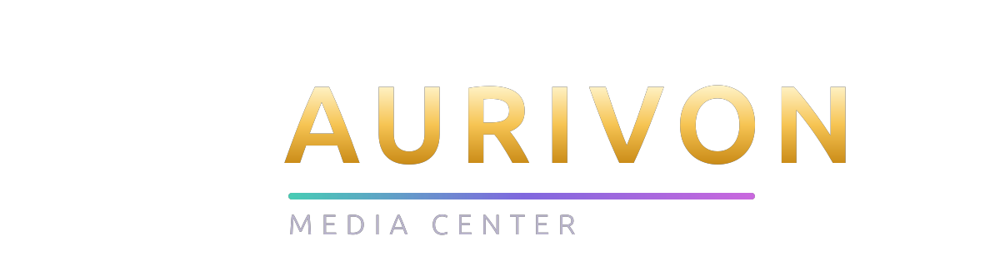

# Aurivon brand

Aurivon = *aurum* (gold) + the lyre + the aurora. The mark is a gold lyre whose
strings frame a play button, under an aurora ribbon, on a warm black tile.

## Logo files

| File | Use |
| --- | --- |
| `assets/brand/aurivon-mark.svg` | Master mark (48 px and up) |
| `assets/brand/aurivon-mark-small.svg` | Simplified mark for 16–32 px (no strings, bolder strokes) |
| `assets/brand/aurivon-wordmark.svg` / `.png` | Mark + "AURIVON" + "MEDIA CENTER" |
| `packaging/icons/aurivon.svg` | Scalable launcher icon (`hicolor/scalable/apps`) |
| `packaging/icons/aurivon-{16,22,24,32,48,64,128,256,512}.png` | hicolor PNGs (desktop entry, window icon via `app_id`) |
| `crates/rmh-gpui/assets/logo-128.png` | Embedded in the binary for the sidebar, Settings and empty states |

Rendering the PNGs again: `ffmpeg -width N -height N -i aurivon-mark.svg aurivon-N.png`
(the small SVG for N ≤ 32).

Usage: keep the tile; give it at least ¼ of its size as clear space; don't recolour
the lyre (it stays gold on every theme); on light backgrounds use the tile as is.

## Colour

| Token | Hex | Use |
| --- | --- | --- |
| Gold | `#F6C453` | Logo, wordmark, ratings, Aurum accent |
| Gold light / deep | `#FFF3C8` / `#C98A16` | Gradient stops of the lyre |
| Aurora | `#2EE6C5` → `#7C5CFF` → `#E35CFF` | Ribbon, Aurora theme, secondary gradients |
| Scrim | `#0A0B10` | Behind text on backdrops |

## Themes (Settings → Appearance)

| Theme | Canvas | Surface | Accent | Accent 2 |
| --- | --- | --- | --- | --- |
| **Aurum** (default) | `#0B0A0F` | `#17151E` | `#F6C453` | `#E0902A` |
| Midnight | `#070B17` | `#0F1830` | `#5B9DFF` | `#8F6BFF` |
| OLED Black | `#000000` | `#0C0C0C` | `#F6C453` | `#FFFFFF` |
| Aurora | `#080C12` | `#101A24` | `#2EE6C5` | `#9B6BFF` |
| Light | `#F7F5F0` | `#FFFFFF` | `#B7790B` | `#7C5CFF` |
| Violet (classic) | `#0A0B10` | `#14161F` | `#8B7CFF` | `#4CC9F0` |

An accent override (8 presets) and "follow system light / dark" sit beside the themes.
All palettes live in `crates/rmh-gpui/src/theme.rs` (`THEMES`, `palette_for`).

## Design tokens (`theme::tokens`)

- Radii: 6 / 10 / 14 / 20 px, pills fully rounded
- Spacing: 4 px grid (4, 8, 12, 16, 24, 32, 40)
- Type: 12 / 14 / 16 / 20 / 28 / 40 px (caption → display); titles semibold, hero bold
- Elevation: card 8, raised 18, overlay 36 px blur
- Motion: 120 / 200 / 360 ms; hero carousel dwell 9 s
- Layout: sidebar 220 px, icon rail 76 px

## Layout options

- Home: **Streaming** (default: hero carousel + rows), Cinematic (tall hero),
  Compact (no hero, small dense rows), Continue & Up Next, Discover, Library
- Cards: posters or landscape backdrops; small / medium / large
- Navigation: sidebar, icon rail, top bar
